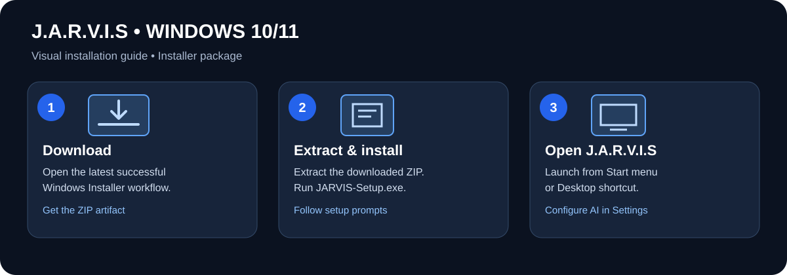
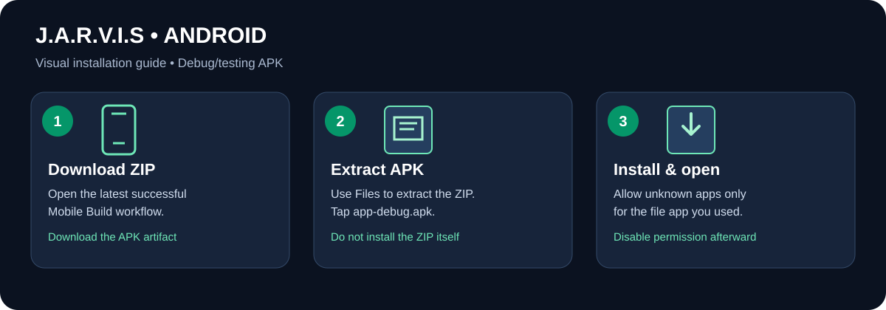
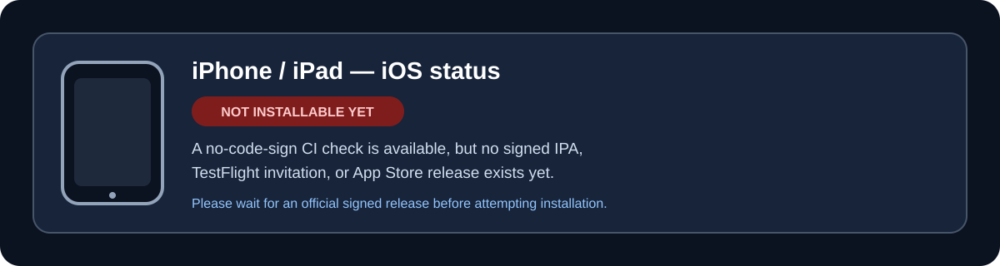

# ORVIX AI Desktop Assistant — Windows 11

**Latest source:** `Zobaerio-Jarvis-AI/`  
**Version:** 1.7.3 — bounded voice timeouts  
**Repository:** https://github.com/zobaerio/orvixai

The latest readable source tree is committed under `Zobaerio-Jarvis-AI/`. Download/clone this repository, then open that folder and run `install.bat` followed by `run.bat`. Use Python 3.12.x 64-bit on Windows 11.

## New in v1.2.3
- A **OPEN REAL 3D AVATAR STUDIO** button in the desktop dashboard.
- Three.js procedural 3D character meshes for LUNA, RUBY and MAYA with separate body parts, idle motion, waving, blinking and simulated speaking-mouth movement.
- **IMPORT RIGGED .GLB** lets you load a model from your own computer. The browser parses that model locally and does not upload the GLB file.
- Embedded idle/default and named wave/talk clips can be played if they exist inside the imported model.
- A feature inventory and a Bengali guide for generating, rigging and importing your own 3D character.
- Local task history (last 100 tasks), user-confirmed retry, a persistent FIFO command queue, and cooperative cancellation with a cancel control in the desktop dashboard and approval dialog.
- Approval-gated single-file copy/move/rename within allow-listed user folders, with no-overwrite and symlink/path-traversal protection.
- Approval-gated opening of common document/data/image files through Windows default apps; scripts and executables are blocked.
- Consent-gated reading of selected text files with path/size disclosure, provider-transmission notice, symlink/binary blocking and recheck for file changes.
- Task history updates use path-level thread locks, unique fsynced temporary files, atomic replacement and a `.bak` recovery file.
- Settings includes a non-generative `/models` connection check; malformed URLs are rejected and stored API keys are never sent over remote plain HTTP.
- Settings are atomically saved with a local recovery backup and fall back to that backup when the primary JSON becomes unreadable.
- Files can be sent to the Windows Recycle Bin only after approval; this is not a permanent-delete capability.
- AI provider error bodies and raw exception messages are hidden; malformed provider responses return safe diagnostics.
- On startup, stale running tasks are marked failed rather than silently remaining active or being automatically replayed; queued tasks stay queued.
- Create bounded ZIP archives from selected files with explicit approval, source-change checks, no-overwrite publication and source files left unchanged.
- Find duplicate files read-only by local SHA-256 hashes within bounded, user-approved folders; never delete or alter files.
- Consent-based text search across allow-listed user folders, with bounded file/result limits and a warning that matching snippets may reach the configured AI provider.
- A consistent ORVIX AI icon/wordmark generated from SVG source, installed as the Windows shortcut/window icon, and responsive desktop layout for smaller resizable windows.
- Approved foreground-app actions: title-only window discovery, user-confirmed text paste, strict allow-listed shortcuts, and deterministic checks for local file/folder existence or visible window titles.

The built-in characters are stylized procedural models—not photorealistic or 1:1 recreations of the reference drawings. The app does not automatically generate a matching 3D model from those pictures or invent absent animation clips. For close likeness, create/license a rigged GLB with the needed motion clips first. Natural walking, hair/cloth physics, expressive facial rigging and phoneme-level lip-sync remain unfinished. Maya's supplied source is only a portrait and cannot define missing full-body geometry. The viewer loads Three.js from a CDN and needs internet access plus WebGL support.

Task history and queued commands are stored in `%APPDATA%\\Zobaerio\\ORVIX\\task_history.json` as local, unencrypted JSON. Avoid entering secrets as commands. Saved queued commands require explicit resumption after an app restart. Cancellation cannot interrupt an in-flight model network read immediately and cannot undo an action already started.

## AI Agent desktop actions

Task History distinguishes `COMPLETED`, `PARTIAL`, `FAILED` and `CANCELLED`. Known provider/configuration failures and malformed responses are marked failed; tool exceptions or the agent action budget are marked partial. A selected command that is still `QUEUED` can be cancelled from Task History before execution; tasks that have started cannot be cancelled using that queue control. Task History also supports local search across command/result/progress/tool metadata and filtering by outcome status. This is execution-status reporting, not proof that the user's semantic goal or document quality was achieved.

The AI agent can inspect visible window titles (not their contents), paste text into a named Windows app, send one allow-listed editing/navigation shortcut, and check basic outcomes such as file/folder existence or a visible window title. Each paste/shortcut asks for confirmation. This is not semantic verification of document quality or task intent; screenshot vision and arbitrary mouse clicking are not implemented.

## Branding and responsive UI

The official SVG mark and wordmark are in `Zobaerio-Jarvis-AI/assets/branding/`. The installer generates a PNG and multi-size Windows ICO with Pillow, then assigns the ICO to the Desktop shortcut. The app uses the same logo in the header/title bar. The desktop window can shrink to 820×560; the right-side utility rail and decorative top nav collapse at narrower widths. The Flutter mobile client is available as an Android debug build through GitHub Actions; it is not yet a signed production release and does not provide full Windows desktop-agent parity.

## Guides
- [Bengali installation guide](Zobaerio-Jarvis-AI/README_BN.md)
- [Feature status and roadmap](Zobaerio-Jarvis-AI/FEATURE_STATUS.md)
- [3D character generation and rigging guide (Bangla)](Zobaerio-Jarvis-AI/3D_CHARACTER_PIPELINE_BN.md)

## Install and test
1. Download this repository (or clone it) and open `Zobaerio-Jarvis-AI/`.
2. Install [Python 3.12.10 64-bit](https://www.python.org/downloads/release/python-31210/).
3. Run `install.bat`, then `run.bat`.
4. Click **OPEN REAL 3D AVATAR STUDIO** and then **IMPORT RIGGED .GLB** to load your own model.
5. Review the feature status before assuming every planned feature is implemented.

## Safety and QA
Only allow-listed desktop tools are enabled by default; supported file/folder changes ask for approval. Voice services may transmit audio/text to their providers. Syntax, unit tests and JavaScript module parsing run in GitHub Actions; target-device GPU/WebGL, microphone and speaker tests are still required.

## Privacy-safe diagnostics export

Task History can export a support report after explicit confirmation. It contains aggregate task/outcome/action counts, UTC date and duration summaries, app version, OS family and Python version. It excludes task IDs, prompts/commands, result text, file paths and names, progress text, tool names/arguments/outputs and exception details. The export is a JSON file you choose locally; review it before sharing.

## Safe exception reporting

Unexpected tool/worker errors show a bounded exception type and next-step guidance, not raw exception strings that might include local paths, account identifiers, or other sensitive data. Tool-result text is no longer copied into Task History progress events. The full underlying exception detail is intentionally withheld from the user/provider response path.

## Windows portable build

A reproducible PyInstaller one-folder build is defined in `Zobaerio-Jarvis-AI/ORVIX.spec` and `build_portable.bat`. On Windows with Python 3.12 x64, run `install.bat` only if you want the source-based setup; to create a portable package, open `Zobaerio-Jarvis-AI` and run `build_portable.bat`. The output is `dist/ORVIX-Windows-Portable.zip`. GitHub Actions also builds this ZIP on Windows and uploads it as a 14-day workflow artifact. This is an **unsigned** portable build, not a signed installer/MSIX. Online AI endpoints, speech services, and the 3D viewer's Three.js CDN still require their respective connectivity; this does not make the app fully offline.

## Voice reliability

Voice recognition now has a bounded provider-operation timeout, and Edge TTS synthesis/playback is time-limited so a stalled speech service cannot keep the voice worker waiting indefinitely. The local fallback remains best-effort. Microphone, speaker, network, and Windows hardware testing is still required.

## Local system health check

The **RUN SYSTEM HEALTH CHECK** control runs fast local preflight checks for the Python runtime, Windows platform, bundled 3D/branding assets, runtime dependencies, endpoint/model configuration, and—only for cloud endpoints—whether an API key is available in secure storage. It does not send a request to the model endpoint, record microphone audio, inspect user files, or reveal endpoint/API-key values. Local Ollama endpoints do not require a key. Use Settings' separate connection test to check provider reachability.

## v1.7.2 reliability fix

The cloud API-key health check now calls the secure keyring getter with its correct zero-argument signature. A regression test confirms that key availability is reported without displaying the secret value.

## API key quick setup

In Settings, **AUTO SETUP FROM API KEY** recognizes supported OpenRouter, OpenAI, Groq, and Google Gemini API key formats, requests the identified provider's HTTPS model catalog, and selects a recognizable chat model. The key is stored using the existing Windows credential-store integration, not in the settings JSON. Unknown or ambiguous key formats are not sent to guessed providers; configure the provider's OpenAI-compatible base URL and model in Advanced Settings instead. This is not universal native-provider support: an API key alone cannot establish compatibility with every provider, and model discovery does not prove chat generation or tool calling works. After setup, save settings, test the connection, and verify a real chat/task. Provider billing and usage limits still apply.

## Install ORVIX AI on Windows, iPhone/iPad (iOS), and Android

**Official project links**
- [Permanent releases and downloads](https://github.com/zobaerio/orvixai/releases)
- [ORVIX AI GitHub repository](https://github.com/zobaerio/orvixai)
- [All GitHub Actions builds](https://github.com/zobaerio/orvixai/actions)
- [Windows Installer build workflow](https://github.com/zobaerio/orvixai/actions/workflows/windows-installer-build.yml)
- [Windows Portable build workflow](https://github.com/zobaerio/orvixai/actions/workflows/windows-portable-build.yml)
- [Android/iOS Mobile build workflow](https://github.com/zobaerio/orvixai/actions/workflows/mobile-build.yml)

For everyday installation, first check the [Releases page](https://github.com/zobaerio/orvixai/releases). Download the Windows installer, portable ZIP, or Android APK attached to the latest successful release. Use the temporary Actions-artifact instructions below only when testing a build that has not yet been published as a release.

### 1. Windows 10/11 — Installer (recommended) or Portable version

### Windows installation — visual steps

#### Option A — Install using the Windows installer
1. Open the [Windows Installer workflow](https://github.com/zobaerio/orvixai/actions/workflows/windows-installer-build.yml).
2. Select the newest run marked **Success** (green tick). Open the run details.
3. Scroll to **Artifacts** and download **ORVIX-Windows-Installer** (ZIP).
4. Extract the ZIP first. Inside it, locate and run `ORVIX-Setup.exe`.
5. Follow the installer prompts. After installation, launch **ORVIX AI** from the Start menu or Desktop shortcut.

**Windows security note:** The installer is currently unsigned, so Windows SmartScreen may show a warning. Check that the file came from this repository and review the warning before deciding whether to continue. Never run installers from unknown sources.

#### Option B — Portable ZIP (no installation wizard)
1. Open the [Windows Portable workflow](https://github.com/zobaerio/orvixai/actions/workflows/windows-portable-build.yml).
2. Select the latest **successful** run and download **ORVIX-Windows-Portable** from **Artifacts**.
3. Extract the ZIP to a folder you control, such as Documents\ORVIX.
4. Open the extracted folder and run `ORVIX.exe`. Keep the extracted app folder and its files together; do not move only the EXE.

#### Option C — Run from source
1. Download the [repository ZIP](https://github.com/zobaerio/orvixai/archive/refs/heads/main.zip) or clone the repository.
2. Open the `Zobaerio-Jarvis-AI/` folder.
3. Install [Python 3.12.x for Windows](https://www.python.org/downloads/).
4. Run `install.bat`, then `run.bat`.

**AI setup:** After opening ORVIX AI, use Settings to configure a supported AI provider and API key, then test the connection. Provider billing, quotas and internet access may apply. Never share your API key publicly.

### 2. Android phone/tablet — APK

### Android installation — visual steps

1. Open the [Mobile Build workflow](https://github.com/zobaerio/orvixai/actions/workflows/mobile-build.yml).
2. Open the newest run marked **Success** and look for the **Android debug APK** job.
3. Scroll to **Artifacts** and download `jarvis-mobile-android-debug` (ZIP).
4. On your Android device, extract the ZIP using the Files app or another archive app.
5. Open the extracted folder and tap `app-debug.apk`.
6. If Android asks, allow **Install unknown apps** only for the specific file manager or browser you used. Return to the APK and tap **Install**.
7. Open **ORVIX AI** from your app list. Turn off the temporary “install unknown apps” permission if you enabled it.

**Android limitations:** This is a **debug/testing APK**, not a production release APK or AAB. The mobile client is an early AI chat client and does not yet provide all Windows desktop automation features. AI features may need a compatible provider configuration/API key and an internet connection. Only install the APK downloaded from this project's official Actions workflow.

### 3. iPhone or iPad — iOS/iPadOS

**An installable iPhone/iPad release is not available yet.** The current [Mobile Build workflow](https://github.com/zobaerio/orvixai/actions/workflows/mobile-build.yml) runs an iOS compile check using `--no-codesign`; it does not produce a signed IPA, TestFlight invitation, or App Store release. Therefore, there is currently no iOS package that you can install from the GitHub Actions artifacts.

When an official iOS release is available, the intended user flow will be:
1. Open the official TestFlight invitation or App Store listing shared by this project.
2. For a TestFlight beta, install [TestFlight from the App Store](https://apps.apple.com/app/testflight/id899247664), open the invitation link, and follow Apple's install prompts.
3. For a public release, install ORVIX AI directly from its official App Store listing.

Helpful official Apple references: [TestFlight](https://developer.apple.com/testflight/) and [Apple's app distribution documentation](https://developer.apple.com/documentation/xcode/distributing-your-app-for-beta-testing-and-releases). These links explain Apple's distribution process; they do **not** mean that this project already has a TestFlight build or App Store listing.

### Troubleshooting

- **No Artifacts section:** Check that you opened a completed successful run and the relevant build job finished.
- **Artifact expired or download fails:** Actions artifacts expire. Open the relevant workflow page and use the newest successful run.
- **Windows SmartScreen warning:** The Windows packages are currently unsigned. Verify the source before running them.
- **Android says “Can't install app”:** Extract the ZIP first and open the actual APK. Check free storage and Android compatibility; an older build with a conflicting app signature may need to be uninstalled first.
- **The app opens but AI does not answer:** Check internet access, provider/base URL, model name, API key and usage quota in Settings. Never post API keys in issues, screenshots or public chats.
